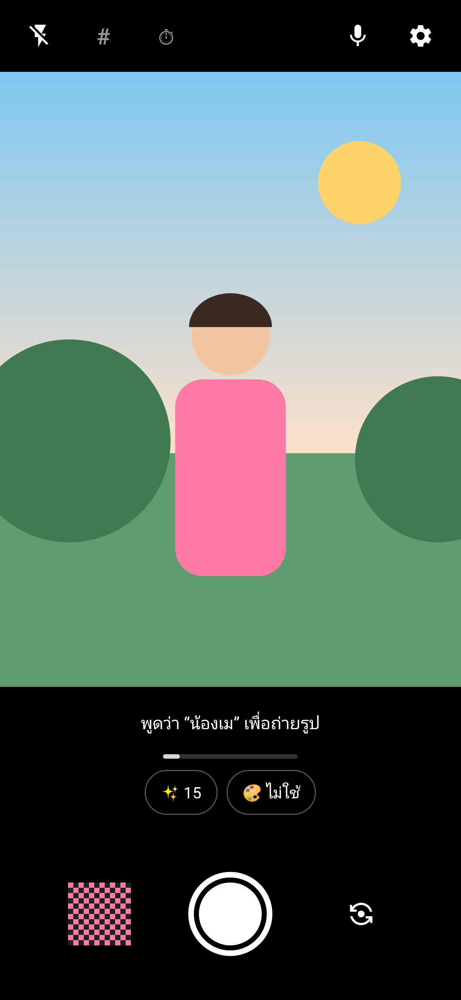
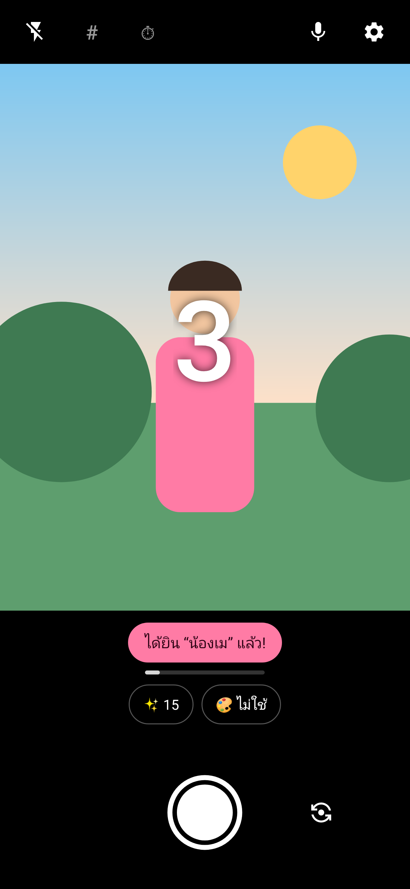
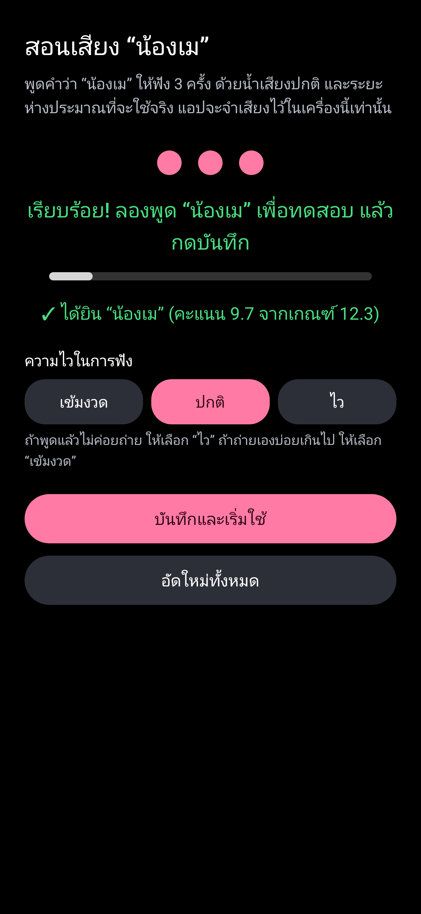

# กล้องน้องเม 📸

แอปกล้องถ่ายรูปสำหรับ Android ที่มีความสามารถพิเศษอย่างเดียว:
**พูดว่า “น้องเม” แล้วกล้องจะถ่ายรูปให้เอง** เหมาะกับตอนตั้งมือถือไว้ไกล ๆ หรือถ่ายรูปหมู่

| หน้ากล้อง | ได้ยิน “น้องเม” แล้วถ่าย | สอนเสียง |
|---|---|---|
|  |  |  |

## ดาวน์โหลด

👉 **[ดาวน์โหลด NongMayCamera-1.0.apk](https://github.com/jiepol/Nongmay-camera/raw/main/NongMayCamera-1.0.apk)** (0.8 MB) — ใช้กับ Android 8.0 ขึ้นไป

## วิธีติดตั้ง

1. กดลิงก์ด้านบน **ในมือถือ** แล้วเปิดไฟล์ที่ดาวน์โหลดมา
2. ถ้ามือถือถาม ให้กด **อนุญาตให้ติดตั้งแอปที่ไม่รู้จัก** (สำหรับ Chrome หรือแอปไฟล์ที่ใช้เปิด)
3. ถ้า Google Play Protect เตือนว่าไม่รู้จักแอปนี้ ให้กด **รายละเอียดเพิ่มเติม → ติดตั้งต่อ**
   (เตือนเพราะแอปไม่ได้มาจาก Play Store)
4. ถ้ามือถือขึ้นว่าแอปมาจาก **นักพัฒนาที่ยังไม่ได้ยืนยันตัวตน** (กฎใหม่ของ Google ในไทยตั้งแต่ปลายปี 2026)
   ให้ทำตามที่มือถือบอก: เปิด *ตัวเลือกสำหรับนักพัฒนา* → อนุญาตแอปจากนักพัฒนาที่ไม่ได้ยืนยัน → รีสตาร์ต → รอ 24 ชั่วโมง (ทำครั้งเดียว)

## วิธีใช้

1. เปิดแอป แล้วกด **อนุญาตกล้อง**
2. แตะปุ่มชมพู **“แตะเพื่อสอนเสียง น้องเม”** แล้วอนุญาตไมโครโฟน
3. พูด **“น้องเม”** 3 ครั้ง ด้วยน้ำเสียงปกติ แล้วกด **บันทึกและเริ่มใช้**
4. กลับมาที่หน้ากล้อง พูด **“น้องเม”** → ถ่ายเลย 📸

ถ่ายด้วยปุ่มกลม หรือปุ่มเพิ่ม/ลดเสียงข้างเครื่องก็ได้ ตั้งนับถอยหลังได้ใน ⚙ ตั้งค่า
รูปอยู่ในอัลบั้ม **Pictures/NongMay**

เคล็ดลับ: พูด “น้องเม” เป็นคำเดี่ยว ๆ แล้วหยุดสั้น ๆ ถ้าพูดต่อเป็นประโยคยาว กล้องจะไม่ถ่าย (กันถ่ายเองตอนคุยกัน)

## ความเป็นส่วนตัว

- แอป **ไม่มีสิทธิ์ใช้อินเทอร์เน็ตเลย** จึงส่งเสียงหรือรูปออกไปไหนไม่ได้
- ฟังไมโครโฟนเฉพาะตอนเปิดหน้ากล้องอยู่ ไม่อัดเสียงเก็บไว้
- จดจำเสียงในเครื่องทั้งหมด

## ตรวจสอบไฟล์ (ไม่จำเป็น)

- SHA-256 ของไฟล์ APK: `2e4c6cbc9feae1c4df28e8ab0011a2830627deb6a7522c28e2d03c1e78535873`
- SHA-256 ของใบรับรองที่เซ็นแอป: `6E:7C:1E:42:34:90:07:CD:A5:42:2D:EB:CB:55:38:C2:80:7D:83:FB:F1:0F:6E:6F:99:35:E3:57:2A:F4:63:14`

เวอร์ชันนี้ยังไม่ได้ทดสอบกับมือถือหลายรุ่น ถ้าใช้แล้วติดปัญหา บอกเจ้าของได้เลย 🙏
